<picture>
  <source media="(prefers-color-scheme: dark)" srcset="logo-dark.svg">
  
</picture>

### Hi, I'm Bardia

I'm a software engineer in Bern with an MSc in Biomedical Engineering. I'll build anything from firmware to front end, and I'm happiest when the code ends up in something you can touch.

By day I'm at SensoPro, where my time goes to embedded systems, the software around them, and a bit of computer vision. Mostly Python and TypeScript, plus C/C++ when the hardware insists.

And by night I'm Batman. 

**On the side**
- [CD3](https://github.com/Bbardia/CD3): local-first C4 architecture visualizer in 2D and 3D
- [Sante](https://github.com/Bbardia/Sante): inventory and product platform
- [rehaPose](https://github.com/Bbardia/rehaPose): real-time body joint angle analysis from pose estimation
- [human_reflex](https://github.com/Bbardia/human_reflex): a party game played with your body

[Website](https://bardia-amiryavari.ch) · [LinkedIn](https://www.linkedin.com/in/bardia-amiryavari)
